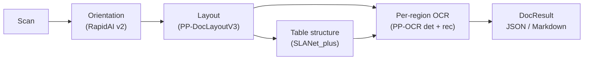

Plain OCR returns text lines. The document pipeline (`DocPipeline`, since 0.4.0) goes further: it corrects the page rotation, finds typed regions (title, paragraph, table, figure, ...) in reading order, runs OCR per region, recovers table structure with row/column spans, and renders the page as JSON or Markdown. It is pure Rust on `rten`; no extra native dependency.



> [!NOTE]
> The OpenCV backend (`use-opencv`) is not supported by these stages. Use the default pure-Rust image backend.

---

## 1. Download the models

```bash
pip install rten-convert   # needed only for --convert-rten
scripts/download_doc_models.sh --convert-rten
```

The script downloads three ONNX models into `models/DocOCR` (`--output-dir` changes the directory), verifies their SHA-256 checksums and, with `--convert-rten`, converts each to `.rten`. It does not install `rten-convert`. The `.onnx` files are always kept: the table dictionary is read from the ONNX metadata when you load the `.onnx` file, and the loaders fall back to `.onnx` when the `.rten` file is missing.

| File | Model | Licence |
| --- | --- | --- |
| `orient_rapidai_v2.rten` | RapidAI page orientation v2 (0/90/180/270) | Apache-2.0 |
| `layout_ppdoclayoutv3.rten` | PaddlePaddle PP-DocLayoutV3 (25 labels) | Apache-2.0 |
| `table_slanetplus.rten` | PaddlePaddle SLANet_plus table structure | Apache-2.0 |

You also need the usual PP-OCR detection and recognition models and dictionary (see [Models & Tiers](/en/advance-guide/models-and-tiers)).

---

## 2. Library example

The complete program is `examples/document_layout.rs`:

```bash
cargo run --release --example document_layout -- \
    page.jpg models/det.onnx models/rec.onnx models/dict.txt models/DocOCR
```

```rust
use rusto::image_impl::imread;
use rusto::{
    DocPipeline, DocPipelineConfig, InitializeConfig, LayoutConfig, OrientConfig, StageState, TableStructureConfig,
};

let config = DocPipelineConfig::new(
    LayoutConfig::default("models/DocOCR/layout_ppdoclayoutv3.rten"),
    InitializeConfig::ppv5("det.onnx", "rec.onnx", "dict.txt"),
)
.with_orientation(OrientConfig::rapid_orientation_v2("models/DocOCR/orient_rapidai_v2.rten"))
.with_table_recognizer(TableStructureConfig::slanet_plus("models/DocOCR/table_slanetplus.rten"));
let mut pipeline = DocPipeline::new(config)?;

let image = imread("page.jpg")?;
let (result, corrected_page) = pipeline.run_with_image(&image)?;

println!("{}", result.to_markdown());
for status in &result.stages {
    if let StageState::Failed { reason } = &status.state {
        eprintln!("{:?} failed: {reason}", status.stage);
    }
}
```

`DocPipelineConfig` is `#[non_exhaustive]`: build it with `DocPipelineConfig::new(layout, ocr)` and the `with_*` builders. `Stage`, `StageState` and `RegionRole` are `#[non_exhaustive]` as well, so a `match` on them needs a `_ =>` arm. Orientation and table recognition are optional; without them the stage is reported as `Skipped`.

`DocResult` holds `width`/`height` (of the corrected page), `orientation` (`None` when the stage is skipped), `regions` (in reading order, each with `index`, `label`, `bbox`, `score`, `text`, `lines`, `table`) and `stages`.

---

## 3. Command line

```bash
# Document JSON with regions, reading order and tables
rusto-rs --det-model det.onnx --rec-model rec.onnx --dict dict.txt \
    --enable-orient --enable-layout --enable-table --format document page.jpg

# Markdown, and keep the corrected page
rusto-rs --det-model det.onnx --rec-model rec.onnx --dict dict.txt \
    --enable-layout --enable-table --format markdown --save-corrected corrected.png page.jpg
```

| Flag | Meaning |
| --- | --- |
| `--enable-orient` | Run page orientation (also in plain OCR mode). |
| `--orient-model` | Orientation model; requires `--enable-orient`; default `models/DocOCR/orient_rapidai_v2.rten`. |
| `--enable-layout` | Run the document pipeline. Accepts only `--format document` or `--format markdown`. |
| `--layout-model` | Layout model; requires `--enable-layout`; default `models/DocOCR/layout_ppdoclayoutv3.rten`. |
| `--enable-table` | Recover table structure; requires `--enable-layout`. |
| `--table-model` | Table model; requires `--enable-table`; default `models/DocOCR/table_slanetplus.rten`. |
| `--save-corrected` | Write the corrected page; requires `--enable-layout`. Only `.png`, `.jpg` and `.jpeg` (case-insensitive) are accepted; the format follows the extension. |

> [!WARNING]
> Behaviour change in 0.4.0: `--orient-model` without `--enable-orient` is now a command-line error, and `--enable-orient` now really runs the orientation model. In plain OCR mode the returned coordinates stay in the original scan; only the document pipeline reports the corrected page.

---

## 4. Coordinate space and orientation

All boxes in a `DocResult` (region `bbox`, text line `box_points`/`frame`, table cell `bbox`, unassigned lines) are in pixels of the **corrected page**, that is the scan after the orientation rotation. `run_with_image` returns that corrected page as its second value, and `width`/`height` of `DocResult` are its size.

`orientation.applied_degrees` is the clockwise rotation that was applied to the scan to obtain the corrected page (0, 90, 180 or 270). It is 0 when the classifier confidence is below the pipeline threshold (default 0.6); `orientation.detected_degrees` is the model's raw class and `confidence` its score. To get boxes in scan space, map them back:

```rust
use rusto::rotate_box_back;

let p = result.orientation.unwrap();
let in_scan = rotate_box_back(&region.bbox, p.applied_degrees, result.width, result.height);
```

> [!WARNING]
> Always check `result.stages`. A stage with `StageState::Failed` does not abort the page. In particular, if the `Orientation` stage is `Failed`, the page was **not** rotated, so the boxes are in scan space even if you expect a corrected page. A failed region or table is reported in its stage and the remaining regions are still returned.

---

## 5. Label to Markdown map

| Label | OCR | Markdown |
| --- | --- | --- |
| `doc_title` | yes | `# ` heading |
| `paragraph_title` | yes | `## ` heading |
| `text`, `content`, `abstract`, `aside_text`, `reference`, `reference_content` | yes | paragraph |
| `footnote`, `vision_footnote` | yes | `[^n]` definitions after the body |
| `vertical_text` | yes (crop rotated both ways, better reading kept) | paragraph |
| `figure_title` | yes | italic caption; moved behind an image, chart or table only when that block is the immediately preceding body block, otherwise kept in model reading order |
| `table` | table pipeline | GFM table, or HTML `<table>` when spans exist |
| `image`, `chart`, `seal` | no | `` placeholder (bbox in JSON) |
| `display_formula`, `inline_formula`, `formula_number`, `algorithm` | no | fenced `formula` / `algorithm` block with the bbox |
| `header`, `footer`, `number`, `header_image`, `footer_image` | text only | trailing `## Page furniture` section |

A text box that lies at least 80 % inside a table, image, chart or seal box is dropped; the container covers it.

---

## 6. Known limitations

- Markdown output does not escape OCR text; characters such as `|`, `*` or `#` in recognised text are written as they are.
- Formulas, algorithms, figures, charts and seals are located but not recognised.
- If OCR of a table crop fails, structure recognition is not attempted for that table.
- Layout, orientation and table models run only on the pure-Rust backend (no `use-opencv`).
- Table cells use SLANet_plus only; SLANeXt model types are rejected.

---

## 7. Performance

Apple M5 Pro, release build, one 1240x1754 page with a table, warm-up then median of 5 (`tests/doc_timing_test.rs`):

| Stage | Time | Design target | Result |
| --- | --- | --- | --- |
| Orientation | 7 ms | at most 10 ms | met |
| Layout | 474 ms | at most 0.8 s | met |
| Table structure only (945x184 crop) | 21 ms | at most 0.1 s per table | met |
| Table stage including crop OCR | about 300 ms | none | n/a |
| Whole page | about 1.9 s | none | n/a |
| Peak memory (RSS) | about 1.7 GB | below 2 GB | met |

All four design targets (orientation, layout, table structure, peak memory) are met on this machine. The targets were set per 300 dpi A4 page with `rten`'s default threading; the measured page is 1240x1754 pixels.

---

## 8. Licences and attribution

- Orientation model: RapidAI, Apache-2.0. Layout and table models: PaddlePaddle PP-DocLayoutV3 and SLANet_plus, Apache-2.0.
- The SLANet_plus pre-processing, structure dictionary and `argmax_tokens` are translated from [bobine](https://github.com/opticsWolf/bobine) 0.7.3 (`src/rapid_table.rs`), used under its MIT option. Copyright (c) 2026 opticsWolf. The full MIT notice is in the header of `src/table.rs`; `src/table_decode.rs` carries the attribution.
